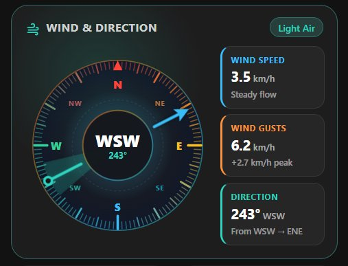

# Wind Compass (`custom:wind-compass`)

A modern, colorful custom Lovelace wind compass and telemetry card for Home Assistant.



## Features

- **Precision Color-Graduated Dial**: 120 color-interpolated degree ticks (`3°` minor, `15°` medium, `30°` major, `90°` cardinal) with a vibrant multi-stop color ring (`N` Red `#ff453a`, `E` Amber `#fbbf24`, `S` Sky Blue `#38bdf8`, `W` Mint `#34d399`).
- **Smooth Shortest-Path Needle**: Origin circle indicator, glowing wind sector cone, and downwind arrow pointer that smoothly animates across the `359° → 0°` boundary.
- **Beaufort Wind Scale Theming**: Dynamically accents card borders, glow, and status badge based on current wind speed (`Calm`, `Light Breeze`, `Moderate`, `Gale`, etc.).
- **Side-by-Side Telemetry**: Wide compass dial on the left and compact color-accented telemetry tiles (`Wind Speed`, `Wind Gusts` with peak delta, and `Direction`) on the right.
- **Native History Integration**: Clicking the compass dial or any metric tile opens Home Assistant's native `hass-more-info` history dialog for that entity.

## Installation

### HACS (Custom Repository)

1. Open **HACS** in Home Assistant → **Frontend** → top-right menu (`⋮`) → **Custom repositories**.
2. Add this repository URL with category **Dashboard** (Lovelace).
3. Install **Wind Compass** and reload your browser.

### Manual Installation

1. Copy `wind-compass.js` to your Home Assistant `config/www/` folder.
2. Add `/local/wind-compass.js` as a **JavaScript Module** under **Settings → Dashboards → Resources**.

## Configuration

```yaml
type: custom:wind-compass
title: Wind & Direction
direction_entity: sensor.openweathermap_wind_direction
speed_entity: sensor.openweathermap_wind_speed
gust_entity: sensor.openweathermap_wind_gust_speed
```

### Options

| Name | Type | Default | Description |
| :--- | :--- | :--- | :--- |
| `type` | `string` | **Required** | `custom:wind-compass` |
| `title` | `string` | `Wind & Direction` | Card header title |
| `direction_entity` | `string` | `sensor.openweathermap_wind_direction` | Sensor entity providing wind bearing in degrees (`0–360°`) |
| `speed_entity` | `string` | `sensor.openweathermap_wind_speed` | Sensor entity providing sustained wind speed |
| `gust_entity` | `string` | `sensor.openweathermap_wind_gust_speed` | Sensor entity providing wind gust speed |
